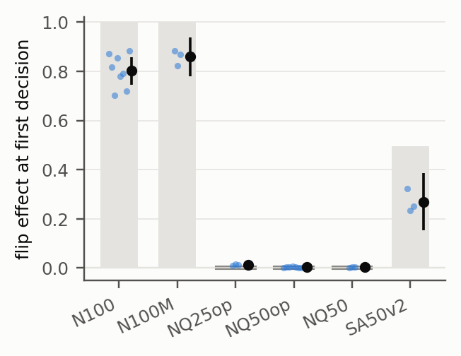

# Know2Act: When Does an Agent's Written Prediction Control Its Next Action?

**Yiwen Lu** (ylu37@nd.edu), University of Notre Dame · Manuscript, 2026 · [PDF](paper/manuscript.pdf) · [Project page](https://eveneureka.github.io/Know2Act/)

Agents are often trained to write a prediction before they act, and people read those predictions to monitor or steer the agent. This project asks when such a written prediction actually controls the decision that follows it. It also asks what in the fine-tuning data decides that.

We study the question in a setting where the prediction carries knowledge that the model can only have learned from fine-tuning. At the decision points we study, the prediction is also the only relevant information in context.

**Short answer.** It depends on whether the training data settle it. When the action always followed the prediction in training, the data never show whether the agent acts on the prediction or on what it has learned. The fine-tuned agent then acts on the prediction: replace it, and 80% of first steps follow the replacement, although deleting it changes almost nothing. When a quarter of the training predictions are contradicted by the action, the agent ignores replaced predictions, as its data imply, while it keeps writing them.

<p align="center"></p>

*Flip effect at the first search step by training arm (dots: seeds; black: mean and 95% CI). Grey: what a perfect imitator of each arm's training data would show, a line where the data determine it and a band where they leave it open. Arms are defined under Design.*

## Findings

The results below come from the held-out test split. The model is Qwen3-4B after supervised fine-tuning. Unless stated otherwise, numbers are for the first search step and for object classes whose convention can be learned.

1. **With training data in which every prediction is followed (`N100`, 8 seeds), the written prediction steers the first decision without being needed.**
   - Deleting the prediction lowers the probability of the predicted move by 0.015. A perfect imitator of these data would not change its move either, because 30% of the training steps teach the action without a prediction.
   - Replacing it with the prediction the agent writes for another object redirects 80% of first steps (0.802, 95% CI 0.745–0.858). The data leave this case open, and the agents follow the prediction.
   - A randomly ordered ranking, a form never seen in training, is followed even more readily (0.90 against 0.80, higher in all eight seeds).
   - In held-out rooms, classes whose location the weights cannot know are redirected just as often (0.81).
2. **When a quarter or half of the training predictions are contradicted by the teacher's action (`NQ25op`, `NQ50op`), the agents do what their data imply: they ignore a replaced prediction, while they keep writing predictions.**
   - They write a prediction at 99.5% of search steps.
   - They follow a replaced prediction in 1.2% and 0.3% of first steps, within 0.012 of a perfect imitator of those data.
   - The registered primary contrast, `N100` minus `NQ50op`, is 0.798 (0.742–0.854). Because `NQ50op`'s imitator reference is 0, its size is set by `N100`.
3. **Unreliable actions leave part of the steering; masking the action loss on note-free steps does not change it detectably.**
   - When half of the search steps ignore correct predictions (`SA50v2`), 27% of first steps are still redirected. That lies between the two imitator references: 0 if the correct steps are credited to the weights, 50% if they are credited to the predictions.
   - Masking the action loss where no prediction is written (`N100M`) gives 0.859, against 0.802 for `N100` (p = 0.09).

All registered tests and predictions, including the ones that failed, are listed with their outcomes in Appendix C of the manuscript; the numbers behind them are in `results/`.

**Scope.** One model (Qwen3-4B), supervised fine-tuning only, one-line template predictions, one synthetic environment.

## The setting: ALF-CF

ALF-CF is ALFWorld with counterfactual object placement. Each learnable object class gets a fixed receptacle class (for example, mugs are kept in the toaster). Each convention was chosen to sit far from both the original ALFWorld placements and the zero-shot rankings of Qwen3-4B and Qwen3-8B.

In 80% of games every instance of the target is moved there. Twelve of the 49 classes are moved to a randomly drawn receptacle class in 80% of games; for them the weights cannot learn a convention.

An object becomes visible only after the agent visits the receptacle that holds it. Until then, a one-line note such as

```
<prediction>The mug is most likely in a toaster, then a garbagecan, then a cabinet.</prediction>
<action>go to toaster 1</action>
```

is the only location information in the agent's context. Knowing the convention saves about two receptacle visits per search. Searching in the order of zero-shot Qwen3's location rankings is worse than uniform search, so the knowledge has to come from fine-tuning.

## Design

Qwen3-4B is fine-tuned with identical hyperparameters in six arms. Each arm differs from `N100` in one respect.

| Arm | Change relative to N100 | Seeds |
|---|---|---|
| `N100` | none: every note states the convention and the next action follows it | 8 |
| `NQ50op` | half of the notes are replaced by another class's convention (foils); actions unchanged; the agent still learns to write notes | 8 |
| `NQ25op` | a quarter of the notes are foils | 3 |
| `NQ50` | as `NQ50op`, but the whole foil note is unsupervised (the agent writes notes at only 0.26 of decision points: 0.005, 0.36 and 0.42 across seeds) | 3 |
| `SA50v2` | notes always correct; half of all search steps follow the standard prior, whether or not a note is written | 3 |
| `N100M` | no loss on actions taken without a note | 3 |

Arm names follow the registered protocol: `N100` has fully reliable notes, `NQ`*q* turns *q*% of the real notes into foils, `op` marks a supervised opener, `M` a masked action loss, and `SA50` makes 50% of search actions follow the standard prior (`v2` is the protocol's version label).

At the first decision point of each test game, the agent's own note is replaced by the note it writes for another object class. We then measure how often the next action follows the replacement (the **flip effect**). We also remove the note, insert a content-free note, and insert a randomly ordered note.

Each arm's flip effect is compared with that of a perfect imitator of its training data (`S_flip*`). Effects that follow from how the data were built are therefore not read as properties of the model.

The primary contrast is `N100` vs `NQ50op` on the held-out test split. Its protocol and analysis script were committed by hash before the test split was opened (to a private, timestamped repository; `sha256sum -c` shows that the released texts are the hashed ones, not when they were written). The texts are in [`protocol/`](protocol/), where `sha256sum -c SHA256SUMS` verifies them.

The per-model test read-outs are in `results/test/`. `python scripts/alfcf_main_analysis.py results/test/manifest_test.tsv out.json` re-runs the frozen study-level analysis. The output matches `results/main_analysis_test.json` up to floating-point rounding in the last digit.

## Reproduce

Model weights and generated training data are not released; the commands below regenerate them. You need an ALFWorld installation with its `json_2.1.1` data and a training environment (PyTorch, transformers, vLLM). The scripts read these environment variables:

| Variable | Meaning |
|---|---|
| `ALFWORLD_ROOT` | ALFWorld data root, containing `json_2.1.1/` and `logic/` |
| `ALFWORLD_JSON` | defaults to `$ALFWORLD_ROOT/json_2.1.1` |
| `ALFCF_DIR` | where generated games and data go; default `data/alfcf_v1` |
| `ALFWORLD_PYTHON` | a python with `alfworld==0.4.2` and `textworld==1.7.0`, used by the evaluation's environment workers |

```bash
# 1. ALF-CF games from the frozen rules (alfcf/rules_v1.json; scripts/alfcf_rules.py re-derives them)
python scripts/alfcf_generate.py alfcf/rules_v1.json $ALFCF_DIR

# 2. Scripted teachers (CPU). Draw d = 0..7 for T+; draws 0..2 for the mixed teacher of SA50v2
python scripts/alfcf_teachers.py $ALFCF_DIR alfcf/rules_v1.json train $ALFCF_DIR/teachers/train_plus_draw0.jsonl --teachers plus --draw 0 --procs 32
python scripts/alfcf_teachers.py $ALFCF_DIR alfcf/rules_v1.json train $ALFCF_DIR/teachers/train_mixall050_draw0.jsonl --teachers mixall --draw 0 --mix 0.5 --procs 32

# 3. Build the arms with their data-construction checks, then tokenise
python scripts/alfcf_build_v3.py $ALFCF_DIR/sft_v3 N100:0 NQ50op:0 NQ25op:0 NQ50:0 N100M:0 SA50v2:0
python scripts/alfcf_tokenize.py $ALFCF_DIR/sft_v3/text_NQ50op_d0.jsonl data/sft/NQ50op_d0.jsonl Qwen/Qwen3-4B

# 4. SFT (configs/sft.json; data-order seed = draw)
torchrun --nproc_per_node 2 scripts/sft_train.py --data data/sft/NQ50op_d0.jsonl --model Qwen/Qwen3-4B \
  --out runs/NQ50op_d0 --lam 0 --lr 1e-5 --epochs 1 --global_batch 64 --max_len 12288 --seed 0

# 5. Evaluation with interventions and counterfactual rollouts (one GPU per shard), then per-model read-outs
python scripts/alfcf_pilot_eval_v3.py --model runs/NQ50op_d0/model --alfcf $ALFCF_DIR --split test \
  --games alfcf/test_games.json --rules alfcf/rules_v1.json --priors alfcf/priors_v1.json \
  --text_ref $ALFCF_DIR/sft_v3/text_N100_d0.jsonl --out results/test/NQ50op_d0 --shard 0/1
python scripts/alfcf_eval_v3_analysis.py results/test/NQ50op_d0 $ALFCF_DIR test results/test/NQ50op_d0/readouts.json

# 6. Study-level analysis, imitator reference and figures
python scripts/alfcf_main_analysis.py results/test/manifest_test.tsv results/main_analysis_test.json
python scripts/alfcf_imitator_reference.py data results/imitator_reference.json
python scripts/alfcf_imitator_reference.py test results/imitator_reference.json results/test/manifest_test.tsv results/imitator_copybias_test.json
python paper/scripts/make_figures.py && bash paper/build.sh
```

`results/test/manifest_test.tsv` lists `arm<TAB>draw<TAB>path/to/readouts.json` for every model. Step 6 reads this released manifest, which points at the released read-outs; to re-analyse new read-outs, point its third column at `results/test/<arm>_d<d>/readouts.json`. One arm × seed takes about 0.6 GPU-hours to train and about 1.5 GPU-hours to evaluate on the 1,396 test games, on two 96 GB GPUs.

## Repository map

| Path | Contents |
|---|---|
| `scripts/alfcf_rules.py`, `alfcf_generate.py`, `alfcf_common.py`, `ft1_prior.py` | ALF-CF rules and game generation |
| `scripts/ft1cf_analysis.py`, `ft4_*.py` | decision value of the convention; zero-shot location rankings |
| `scripts/alfcf_teachers.py` | scripted teachers T⁺, T⁻ and the mixed teacher |
| `scripts/alfcf_build_v3.py`, `alfcf_tokenize.py`, `alfcf_text.py` | SFT data for every arm, with construction checks |
| `scripts/sft_train.py` | SFT trainer (per-token loss masks) |
| `scripts/alfcf_pilot_eval_v3.py`, `alfcf_envworker.py` | rollouts, decision-point interventions, counterfactual rollouts |
| `scripts/alfcf_eval_v3_analysis.py`, `alfcf_main_analysis.py`, `alfcf_imitator_reference.py` | per-model read-outs, frozen study-level analysis, imitator reference |
| `alfcf/` | frozen rules, teacher priors, validation and test game lists |
| `configs/` | SFT hyperparameters, arm definitions, evaluation conditions |
| `results/` | study-level analysis and copy bias, per-model test read-outs (`results/test/`), data-construction checks, imitator reference, zero-shot rankings |
| `protocol/` | byte-identical protocol addenda with checksums |
| `paper/` | manuscript sources, figure scripts and PDF |
| `docs/` | project page |

## Citation

```bibtex
@misc{lu2026know2act,
  title  = {Know2Act: When Does an Agent's Written Prediction Control Its Next Action?},
  author = {Lu, Yiwen},
  year   = {2026},
  note   = {Manuscript},
  url    = {https://github.com/EvenEureka/Know2Act}
}
```

Code is released under the Apache 2.0 license.
