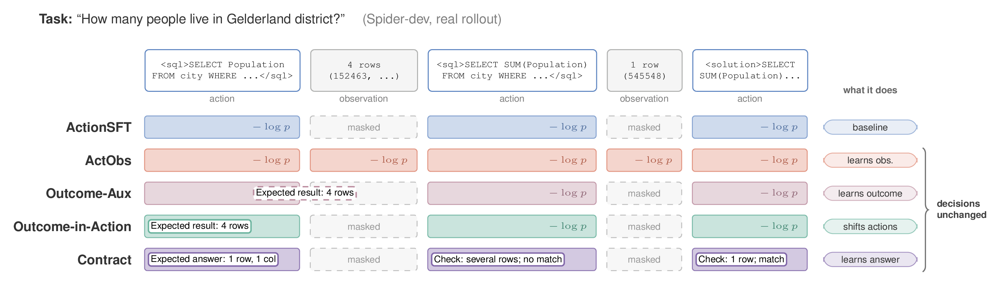

# Know2Act: What Knowledge Reaches a Tool-Using Agent's Actions?

**Yiwen Lu** · University of Notre Dame · Manuscript, October 2026

[Paper (PDF)](paper/manuscript.pdf) · [Project page](https://eveneureka.github.io/Know2Act/) · [BibTeX](#citation)



Tool-using agents are increasingly trained to predict more than their next action: the observations the
environment will return, the outcome of a call, or the answer they are looking for. Between learning such a
prediction and acting on it lie three separate steps: the knowledge must be acquired, it must enter the context in
which actions are chosen, and the decision rule must use it. Know2Act measures each step on its own, in a
pre-registered study of a multi-turn text-to-SQL agent (Qwen3-4B, supervised fine-tuning followed by GRPO in
SkyRL). Every prediction we supervise is learned and transfers to unseen databases, up to a contract that states
the shape of the correct answer; whether it reaches the action policy depends on where it is placed; the learned
contract is usable at once as a selector among sampled answers; but the agent's own decision to submit or keep
querying is unchanged by every variant, and RL, which rewards only the final answer, removes even the selector's gain.

## Findings

| Step | Finding | Key evidence |
|---|---|---|
| 1. Is the knowledge acquired? | Yes, and it transfers to unseen databases | Contract states the correct answer shape in 89% / 82% of rollouts (Spider / BIRD), vs. 71% / 49% from the question alone; observation supervision learns the result template and header (header-start cross-entropy 5.64 → 1.02 nats) but memorises row values (1.92 vs. 1.88 on unseen databases) |
| 2. Does it enter the actions? | Only when placed in the action | The same outcome line moves the policy only inside the action (2.3× the data-order noise floor); as an auxiliary target, and for observation supervision (KL 0.0049 vs. a floor of 0.0070), it stays within the noise |
| 3a. Is it used by a selector outside the agent? | Yes, before RL | Contract-based selection +4.3 / +3.4 points over a validity filter, and +2.6 / +1.4 over execution majority voting when combined with it; nothing after GRPO |
| 3b. Is it used by the agent's own decision? | No | Change in submit-or-continue sensitivity ≤ 0.016 on Spider, vs. 0.033 from reshuffling the training data; holds for Contract, whose own check names every mismatch |
| Does the outcome reward pick it up? | No | ActObs − ActionSFT, pooled pass@16 after GRPO (two seeds each): +0.26 points [−0.38, +0.91]; Contract − ActionSFT: −0.06 [−0.78, +0.66]; RL raises submitting after a reported mismatch from 31% to 46% |

The open step is the last one. Its direct test holds the model and the decision context fixed and replaces or
removes the contract at the point where the agent submits or retries.

We also find that 290 of the 653 training tasks (44%) in SkyRL's public text-to-SQL environment give full reward
to an empty answer, because their gold queries return no rows. We reported this upstream as
[SkyRL issue #2451](https://github.com/NovaSky-AI/SkyRL/issues/2451); `scripts/repro_empty_gold.py` reproduces it,
and RL here uses the 363 tasks with non-empty gold results.

## Repository layout

| Path | Contents |
|---|---|
| `agenticrl/` | SkyRL's text-to-SQL environment with only the two `<think>` format rules removed, and the GRPO entry point |
| `scripts/` | Data construction, teacher rollouts, SFT, evaluation, measurements and analyses (see below) |
| `scripts/jobs/` | SGE job templates for every GPU and CPU stage; edit the queue and path in the header |
| `tests/` | CPU unit tests: SFT stream equals the RL token stream, loss masks, chunked LM head, pass@k |
| `results/` | Summary outputs behind every number in the paper (measurements, decision and selection analyses) |
| `data/sft/` | Statistics of the SFT data and of the inserted lines |
| `prereg/` | Pre-registration with its dated addenda (see below) |
| `paper/` | LaTeX source, tables, figure scripts and the manuscript PDF |
| `docs/` | Project page (GitHub Pages) |

## Reproducing

**Environment.** Edit `scripts/env.sh` (Python, Hugging Face cache, node-local scratch). Our Python environment
used vLLM 0.24, torch 2.11 with CUDA 13, transformers 5.13, pandas 3.0, pyarrow 25 and omegaconf 2.3. GRPO runs
in SkyRL's own environment: clone SkyRL at commit `99824f0` into `skyrl-upstream/` and build the apptainer image
listed in `configs/container.sha256`; `scripts/skyrl_container.sh` checks both before every run. All runs used
NVIDIA RTX PRO 6000 Blackwell GPUs (96 GB), about 280 GPU-hours in total.

**Pipeline.** Each stage reads the outputs of the previous one.

1. *Data.* `scripts/extract_omnisql.py` fetches the Spider and BIRD databases from the OmniSQL release, and
   `scripts/build_datasets.py` builds the RL, evaluation and SFT question sets in SkyRL's row format.
2. *Teacher trajectories.* `scripts/jobs/teacher.sge` runs Qwen3-32B through `scripts/rollout.py`, which
   reproduces SkyRL's multi-turn token stream; `scripts/build_sft_data.py` labels every token as prompt, action,
   observation payload or observation template.
3. *Variants.* `scripts/build_variants.py` (outcome lines), `scripts/build_e3.py` (contract and placebo) and
   `scripts/build_dilution.py` (Wikipedia control) write the SFT data for the other arms.
4. *SFT.* `scripts/jobs/sft.sge` trains one arm with `scripts/sft_train.py`; `LAM=0` is ActionSFT, `LAM=1` ActObs.
5. *GRPO.* `scripts/jobs/grpo.sge` runs SkyRL's GRPO from an SFT checkpoint with the overrides in
   `scripts/grpo_args.sh` (135 steps, 32 tasks × 16 samples, learning rate 1e-6).
6. *Evaluation.* `scripts/jobs/eval.sge` samples 16 attempts per question on Spider-dev and BIRD-dev;
   `scripts/passk.py` computes unbiased pass@k and paired bootstrap intervals.
7. *Measurements and analyses.* `scripts/jobs/measure.sge` and `scripts/jobs/diag.sge` compute action KL and
   observation cross-entropy; `scripts/decision_evidence.py`, `scripts/paper_analyses.py` and
   `scripts/e3_readouts.py` compute decision sensitivity, selection and the pooled primary outcome.
8. *Paper.* `paper/scripts/collect_results.py` summarises the evaluation rollouts (not included; its output is
   `paper/data/results.json`) and `paper/scripts/make_appendix_tables.py` turns `results/` into the tables; `paper/build.sh` builds the review PDF and `paper/build_site_assets.sh` the public PDF and the
   project-page figures.

Each job template starts with a `usage:` line. The unit tests need no GPU:

```bash
python -m unittest discover -s tests
```

One run is still training (Outcome-in-Action after GRPO); its row in Table 1 will be added when it finishes.

## Pre-registration

`prereg/PREREG.md` contains the plan that was frozen on 2026-10-04, before any main SFT or GRPO run, followed by
dated addenda that record every later change together with what had been seen at the time. The frozen original
has MD5 `cb10cce29218b6881e9bc0506ace2fa6`. This public copy differs from the originals only in wording, machine
paths and the names of unrelated projects; the originals are available on request.

## Citation

```bibtex
@misc{lu2026know2act,
  title  = {Know2Act: What Knowledge Reaches a Tool-Using Agent's Actions?},
  author = {Lu, Yiwen},
  year   = {2026},
  note   = {Manuscript},
  url    = {https://github.com/EvenEureka/Know2Act}
}
```

## License

Code is released under the Apache License 2.0. `agenticrl/sql_lenient.py` adapts SkyRL (Apache 2.0). Spider and
BIRD are distributed under CC BY-SA 4.0, and Qwen3 models under Apache 2.0.
